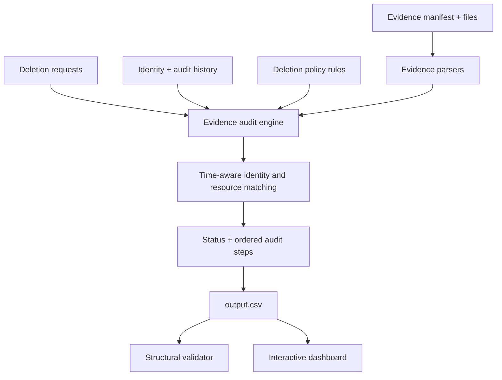

# 👻 Ghost Data Still Exists

> **Evidence-driven deletion auditing | Python · SQLite · JSON · CSV · Streamlit**
>
> A practical privacy-engineering project that checks whether a data-deletion request is actually complete—or whether data may remain in replicas, exports, logs, support systems, search indexes, backups, or active integrations.

[**🚀 Quick start**](#-quick-start) · [**🧭 How it works**](#-approach--architecture) · [**🖥️ Interactive recruiter demo**](#-interactive-recruiter-demo) · [**🧪 Evaluation**](#-evaluation) · [**📁 Project structure**](#-project-structure)

---

## The problem

A workflow saying **“deletion complete” is not proof that personal data is gone**. Replicas can lag, exports can survive, logs may retain identifiers, and backup restoration can recreate records. This project inspects the supplied evidence and produces an auditable assessment for each deletion request.

### What it produces

- One result per request: `COMPLETE`, `INCOMPLETE`, or `NOT_APPLICABLE`.
- Ordered, machine-readable JSON steps for findings, remediation, and verification.
- Evidence references for findings and completed-state verification.
- A CSV output that can be checked by the supplied structural validator.
- A transparent local implementation: **no API key, external model, or paid service required**.

> **Important:** This is a challenge prototype, not a production privacy-compliance certification tool. Review the documented public-sample metrics and limitations before relying on any conclusion.

## 🚀 Quick start

### Requirements

- Python 3.10+ (standard-library implementation; no mandatory Python packages)
- Optional: `pdftotext` to extract text from PDF evidence
- Optional: Streamlit for the interactive browser demo

### 1. Unzip and open the project

```bash
unzip hackerrank-orchestrate-october26-project.zip
cd hackerrank-orchestrate-october26-main
```

### 2. Run the audit

```bash
python3 code/main.py
```

The program reads the supplied files under `dataset/` and writes `output.csv` at the repository root.

### 3. Validate the output format

```bash
python3 code/evaluation/main.py
```

The validator checks the output schema, row count, JSON validity, step numbering, phase ordering, and evidence/step structure. **Structural validity does not mean the predictions match hidden gold answers.**

### 4. Launch the interactive demo (optional)

```bash
python3 -m pip install -r requirements-demo.txt
python3 -m streamlit run code/dashboard.py
```

The dashboard lets a reviewer filter cases by status, search case IDs and request text, inspect individual audit steps, and download the current CSV. Run the audit first so the dashboard displays the latest output.

## 🖥️ Interactive recruiter demo

In a 2–3 minute walkthrough:

1. Run `python3 code/main.py` to generate the audit results.
2. Open the Streamlit dashboard and use the status filter to focus on `INCOMPLETE` cases.
3. Search for a case ID, open the case detail, and review the finding/remediation/verification sequence and evidence references.
4. Download `output.csv` and run the validator to show reproducibility.
5. Open `code/evaluation/evaluation_report.md` to discuss benchmark results and honest limitations.

**Suggested interview question:** How would you improve confidence when an evidence snapshot does not contain a record? A robust next step is to distinguish *absence from a partial snapshot* from *positive evidence of deletion*, then model identity, resources, timestamps, and replication relationships explicitly.

## 🧭 Approach & architecture



### Audit pipeline

1. **Read the request** and determine whether deletion was actually authorized/requested.
2. **Resolve identity** using current identity records and historical identity changes.
3. **Parse evidence** from supported structured snapshots, SQL files, logs, text and optional PDF text.
4. **Respect time boundaries** by considering evidence availability relative to the request's audit timestamp.
5. **Apply deletion rules** for deletion, redaction, anonymization, retention, flow disabling and restore blocking.
6. **Build ordered steps** in finding → remediation → verification order.
7. **Validate and export** one row per request, sorted by case ID, with JSON arrays in `steps_json`.

### Design choices

- **Explainability first:** decisions are produced by inspectable Python rules rather than opaque model outputs.
- **Evidence-linked:** findings should cite evidence IDs; proposed actions should not pretend to have already happened.
- **Reproducible:** the same local input files produce deterministic results.
- **Fail carefully:** missing evidence is not automatically proof that data has been deleted.
- **No external calls:** model/token usage is zero; all inference is local and rule-based.

## 📁 Project structure

```text
.
├── README.md
├── output.csv                       # Generated audit results
├── log.txt                          # Challenge conversation transcript
├── dataset/
│   ├── deletion_requests.csv
│   ├── deletion_rules.csv
│   ├── user_identities.csv
│   ├── user_audit_log.csv
│   ├── system_activity.csv
│   ├── evidence_files.csv
│   └── evidence/                    # SQL, JSON, logs, PDFs, images, etc.
└── code/
    ├── main.py                      # Main audit engine
    ├── dashboard.py                 # Optional interactive Streamlit UI
    └── evaluation/
        ├── main.py                  # Structural validator
        ├── evaluation_report.md
        └── usage_report.md
```

## 📄 Output contract

`output.csv` uses the exact header:

```csv
case_id,deletion_status,steps_json
```

`steps_json` is a JSON array. The challenge expects step numbering to start at 1 and phases to be ordered as findings, remediation, then verification. `NOT_APPLICABLE` cases use an empty array. Each case should have an evidence-backed explanation and actionable follow-up where the evidence supports one.

## 🧪 Evaluation

Run both commands after any code change:

```bash
python3 code/main.py
python3 code/evaluation/main.py
```

The evaluation report documents the public sample benchmark, custom specification-driven tests, failures found, and improvement opportunities. The current baseline has **78.1% status accuracy (25/32)** and **1/32 exact step-array matches** on the public sample. Although the full output passes structural validation, semantic accuracy and step completeness remain areas for improvement. Do not describe structural validation as proof of full correctness.

See [`code/evaluation/evaluation_report.md`](code/evaluation/evaluation_report.md) and [`code/evaluation/usage_report.md`](code/evaluation/usage_report.md) for details.

## 🔐 Privacy & safety notes

- Use only the synthetic challenge dataset in demos.
- Do not add real customer data, API keys, credentials, or secrets to the repository or transcript.
- A production system should enforce access controls, immutable audit logging, legal-retention checks, human review for ambiguous cases, and verified deletion receipts from each data processor.

## 📦 Packaging for HackerRank

The challenge's `code.zip` should contain the runnable source and evaluation reports, **not** the dataset or nested archives. From the project root:

```bash
zip -r code.zip README.md code -x "*/__pycache__/*" "*/.venv/*" "*/venv/*" "*/node_modules/*" "*/.git/*" "*/.DS_Store"
```

Submit root `output.csv` separately and upload `log.txt` as the chat transcript. Before submission, rerun the audit and validator and review the evaluation report's limitations.

---

**Built as a reproducible privacy-engineering challenge prototype.** The strongest next iteration is a time-aware resource graph, deeper evidence parsing (including screenshot OCR), and a field/sequence-level golden test harness.
